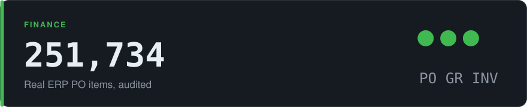

# Three-way match audit

<!-- Hero card: rendered by tarang-tj/tarang-tj (node scripts/render-repo-hero.mjs p2p docs/img), same number as the profile tile. -->
<picture>
  <source media="(prefers-color-scheme: dark)" srcset="docs/img/hero-dark.svg">
  <source media="(prefers-color-scheme: light)" srcset="docs/img/hero-light.svg">
  
</picture>

[](https://github.com/tarang-tj/p2p-match-audit/actions/workflows/ci.yml)
[](https://tarang-tj.github.io/p2p-match-audit/)
[](LICENSE)
[-555)](docs/data-quality.md)

**[Run the audit in your browser](https://tarang-tj.github.io/p2p-match-audit/):** 5,000 real purchase-order items, 13 checks, one at a time. 390 fail at least one (7.80%); across all 251,734 items the same audit flags 7.21%. Tap a check to see only its items, or tap an item to see why it failed.

**Before a supplier gets paid, do the purchase order, the goods receipt and the invoice agree?** A procurement controls audit of a real ERP purchase-to-pay log: 251,734 purchase-order items and 1,595,923 events from one multinational company's 2018 purchasing.

| check | what the log shows |
|---|---|
| Invoice before goods receipt, where the system requires the receipt first | 0 of 15,182 items. The system holds the line. |
| Order raised after the invoice | 3,693 items (1.47%), 1,215 of them from one vendor |
| Invoice cleared with no goods received | 674 of 236,192 three-way items |
| Same person records and clears an invoice | 2,526 items, from 15 people |
| Payment day | 75.06% of clearings happen on a Thursday |

**[Live page](https://tarang-tj.github.io/p2p-match-audit/)** · [Findings memo](docs/findings.md) · [Controls](docs/controls.md) · [What the data cannot show](docs/data-quality.md)

## What it answers

Before a supplier is paid, three documents should agree: the purchase order, the goods receipt and the invoice. This project checks how often that held, where it broke, and how long payment took. It answers the three questions the company's process owner posed with the dataset:

1. **Which process models describe the data?** Variants per matching rule (`src/p2p/variants.py`). Seven variants cover 80% of the 221,010 invoice-before-GR items.
2. **What is the invoice throughput, matching receipts to invoices to payments?** An order-based matcher (`src/p2p/matching.py`, rules in `docs/matching.md`).
3. **Which purchases stand out?** Fourteen controls across conformance, purchasing discipline, rework and segregation of duties (`src/p2p/controls.py`, definitions in `docs/controls.md`).

## Run

```bash
pip install pandas pyarrow lxml flake8   # Python 3.9+
npm install && npx playwright install chromium-headless-shell
# Put BPI_Challenge_2019.xes in data/raw/ (source in docs/data-quality.md)
make data      # parse XES to parquet (~30 s)
make gate      # lint, tests, audit, reconcile, memo trace, browser probe
python3 -m http.server -d web 8000   # open http://localhost:8000
```

## The gate

`make gate` runs every step below; a partial run does not count.

| Step | What it proves |
|---|---|
| lint | flake8 over src, scripts, tests |
| test | 28 unit tests. 24 run hand-built items with known answers; nine planted bugs (ignoring GR reversals, UTC instead of local dates, skipping invoice cancellations, letting a reversal clearing take an older invoice, and others) each turn the suite red. 4 parity tests run the browser audit (`web/audit.js`, under Node) and require the Python answer on every flag of the 5,000 sampled items and of 17 hand-built edge items (local-midnight invoice dates, same-minute events, first vs last events, interface and batch accounts); eleven planted bugs in the port each turn them red |
| audit | Rebuilds every output from the parquet files; byte-identical across runs |
| reconcile | Parsed log equals the publisher's stated counts exactly; each item lands in exactly one flow; no control has more exceptions than items |
| memo | Every number in docs/findings.md traces to out/summary.json |
| site | Rebuilds `web/data/sample.json` (seed 2019) and refuses it unless every sampled flag equals the full-log run. Then headless Chromium at 1440x900 (animated) and 375x812 (reduced motion): the in-browser audit finishes, the headline and all 13 check counts equal `audit.js` on the sample, both shares are right, a tapped cell names its item, every example tab draws its item, no console errors, no horizontal overflow |

## Layout

```
src/p2p/     load_log, features, controls, matching, variants, summarize, data_quality
scripts/     run_audit, reconcile, check_memo, build_site_data, build_sample, verify_boot.mjs, run_browser_audit.mjs
tests/       unit tests and a 3-trace XES fixture
web/         static page (no build step); audit.js is the 13+1 controls in JS; data/site.json and data/sample.json are generated
docs/        findings memo, control definitions, matching rule, data quality
```

Data: BPI Challenge 2019, van Dongen, B.F., 4TU.Centre for Research Data, doi:10.4121/uuid:d06aff4b-79f0-45e6-8ec8-e19730c248f1, licensed CC BY 4.0. This repository publishes derived aggregates, six example items and a random 5,000-item sample with only the events the controls read, not the raw log.

Values in the log are anonymized by linear scaling, so results are counts and shares of ordered value, never euros. Names of companies, vendors and users are the publisher's anonymized IDs. The source does not name the ERP product, and this project does not claim one.
